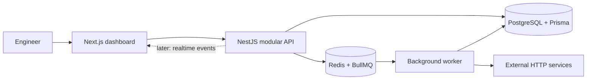

# NEXUS

**Intelligent Operations & API Management Platform**

NEXUS is an early-stage SaaS workspace for monitoring APIs and investigating incidents. Its first vertical slice includes account registration, a personal organization, organization-scoped monitor management, scheduled HTTP checks and API scenarios, reusable request assertions, encrypted API credentials, optional Slack failure alerts, execution history, live summary metrics, incident event timelines, and an in-app notification inbox.

The dashboard uses sample data before sign-in. After sign-in, monitor, metric, incident, event timeline, notification, and hourly availability data come from the authenticated organization. The live chart aggregates stored checks into 24 hourly buckets; the pre-sign-in chart is labeled as demonstration data. Incident notifications are persisted for each organization member and the inbox refreshes every 30 seconds while the workspace is open.

## Product scope

- **Observability Center:** service availability, latency, history, and operational metrics.
- **API Testing Engine:** reusable request scenarios, response assertions, and integration checks.
- **Incident Management:** incident state, evidence, timeline, and notifications.
- **AI Engineering Assistant:** on-demand incident analysis grounded in saved monitoring evidence.
- **Organization & Access Management:** tenant isolation, team membership, and roles.

The MVP prioritizes account and organization setup, monitor registration and controls, asynchronous checks, reusable API scenarios with schedules and execution history, encrypted credential storage, a data-backed dashboard, incident open/resolve transitions, event timelines, in-app notifications, and optional incident analysis. Billing, CI/CD, and cloud deployment remain future work.

## Architecture



The initial architecture is a modular monolith with a separate worker process. PostgreSQL is the source of truth; Redis carries asynchronous monitor and API scenario jobs. The worker re-resolves and pins public DNS addresses, rejects non-public targets, does not follow redirects, and limits request time and response size.

The worker records incident transitions and creates a notification for each member of the incident's organization in the same transaction. The API exposes organization-scoped event history and per-user read state; the web inbox polls the persisted notification feed.

## Local development

Requirements: Node.js 22.12+, npm 10+, and Docker Desktop.

1. Copy `.env.example` to `.env`, replace `JWT_SECRET` with a private random value of at least 32 characters, and set `SCENARIO_SECRET_KEY` to a new 32-byte key. Generate it with `node -e "console.log(require('node:crypto').randomBytes(32).toString('hex'))"` and keep it backed up in a secret manager outside the database and source control. To enable incident analysis, set `OPENAI_API_KEY` in the root `.env`; the key stays on the API server. The analysis request sends HTTP status, latency, timestamps, and incident severity, without monitor names, URLs, or free-text errors.
2. Install dependencies with `npm install`.
3. Start PostgreSQL and Redis with `npm run infra:up`.
4. Generate the Prisma client and apply the local migration with `npm run db:generate` and `npm run db:migrate`.
5. Start the web app, API, and worker with `npm run dev`.

Run the automated unit checks with `npm test`; run the three production builds with `npm run build`. With PostgreSQL and Redis running and the local migrations applied, `npm run test:integration` boots the API and checks registration, sessions, tenant isolation, encrypted credential redaction, viewer permissions, and Redis rate limiting against the real services. GitHub Actions runs an npm vulnerability audit, migrations, unit tests, integration smoke checks, and production builds on pushes and pull requests. CI also checks the worker's SSRF destination policy and API credential encryption.

In Windows PowerShell environments where the `npm.ps1` script is disabled, run those commands with `npm.cmd` (for example, `npm.cmd run db:migrate`). For a deployed environment, apply committed migrations with `npm run db:migrate:deploy`.

The dashboard is at `http://localhost:3000`; the API liveness route is `http://localhost:4000/api/health`, dependency readiness is `http://localhost:4000/api/health/ready`, and the OpenAPI page is at `http://localhost:4000/api/docs`. Register in the dashboard to create the first organization. Database schema and migrations live under `apps/api/prisma`.

## Repository layout

```text
apps/
  api/       NestJS REST API, Prisma schema, and migrations
  web/       Next.js dashboard
  worker/    BullMQ monitoring worker
docs/
  architecture/  ADRs and delivery roadmap
```

## Security and operational principles

- Every tenant-owned query must be scoped by the authenticated organization.
- Monitor and scenario URLs are untrusted input. The worker rejects non-public IP ranges, pins a validated DNS address when connecting, does not follow redirects, and times out requests. Monitor checks close responses after headers; scenario runs buffer at most 1 MB to evaluate configured response assertions.
- API scenarios can send custom headers and JSON bodies. Authentication values and Slack webhook URLs are encrypted with AES-256-GCM using `SCENARIO_SECRET_KEY`; the key stays outside the database. Runs keep encrypted request snapshots so later edits or credential rotations do not change queued work. Back up this key securely; losing it makes saved credentials unreadable.
- Scheduled scenarios run every 5 minutes, 15 minutes, hour, or day. In-app and optional Slack alerts are sent when a scenario first fails and when it recovers, without repeating alerts for every run in the same state.
- Queue handlers persist a unique BullMQ job ID with each check so a retried job cannot create duplicate check records or duplicate incident transitions.
- Secrets are stored outside source control and must be redacted from logs.
- The session cookie is HTTP-only and same-site. Production must use HTTPS and a private `JWT_SECRET`.
- Registration, login, and incident analysis use Redis-backed rate limits. When deploying behind a proxy, configure `TRUSTED_PROXY_CIDRS` with only that ingress's addresses so client IP limits cannot be spoofed through forwarded headers.

## Status

This is an implementation in progress, not a production-ready SaaS yet. CI, focused unit coverage, database-backed integration smoke checks, Redis-backed rate limits, readiness checks, structured API request logs, dependency audit automation, and initial operations/security runbooks are present. Broader E2E coverage, metrics, tracing, deployment configuration, and a verified restore drill remain open. See the [operations runbook](docs/operations/runbook.md), [security review](docs/operations/security-review.md), and [roadmap](docs/architecture/roadmap.md).
